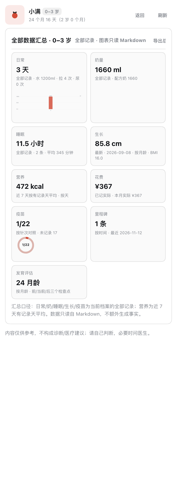
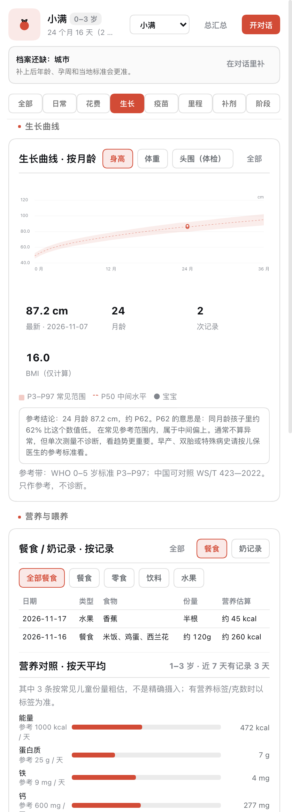
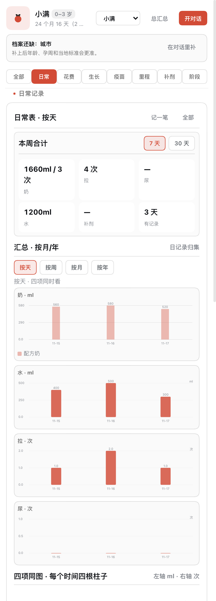

# dsh-ask-grow 🍅

[English](README.md) | [简体中文](README.zh-CN.md)


[](https://awesome-dsh-plugin.com)

A **parenting archive** plugin for [DeepSeek Harness](https://github.com/deepseek-ai/deepseek-harness) (`dsh`): one plain-Markdown archive per child, from pregnancy through age 3.

Open the **问问** tab in the right sidebar, or the **问问** entry in the left rail. The dashboard reads and writes the same Markdown files you can open, diff, back up and edit. There is no separate database, no hosted service and no second source of truth.

*Unofficial project: independently developed and maintained by a community member, not an official DeepSeek product.*

## Screenshots







## What it does

| Area | Details |
|---|---|
| Archives | One workspace directory per child; pregnancy, newborn and 0–3 stages; add a new archive from the **问问** entry. |
| Daily care | Milk, water, poop, pee, supplements and notes, with a proposal-only “carry over yesterday” flow. |
| Milk | Milk type, brand/stage, amount, time and optional nutrition label; milk totals feed the charts. |
| Meals | Meal type (meal/snack/drink/fruit), food, quantity and nutrition estimate. |
| Sleep | Night sleep and naps, start/end, duration and night wakes. |
| Growth | Height, weight and head circumference; age-based curves with a reference band. |
| Vaccines | Official schedule comparison by vaccine + dose; self-paid/combination products recorded in a separate plan. |
| Checkups | Child health checkups, results and advice; height/weight/head can also enter the growth table. |
| Milestones | Timeline of firsts and stage moments, separate from the full event timeline. |
| Assessment | Self-assessment checkpoints and hospital/儿保 assessment notes; screening, not diagnosis. |
| Pregnancy | EDD source, checkups, weight/BP trends, report summaries, medications, meals, hospital bag. |
| Expenses | Actual expenses plus an explicitly labelled estimate when nothing is recorded. |
| Charts | Milk/water/diaper, sleep, growth, nutrition, vaccine and expense views — all read the Markdown data. |
| Dashboard | Recent updates, key metrics, to-dos, due-today notes, quick record cards and a per-module summary. |
| Settings | Workspace, children, region, privacy and developer mode live in this plugin's **Plugin Manager** entry. |

## Data model

Everything is plain Markdown under the configured workspace:

```text
child-doc/
  孕期-<name>-<id>/
  <child>/
    docs/
      <child>-档案.md
      <child>-日常记录.md
      <child>-奶记录.md
      <child>-辅食记录.md
      <child>-睡眠记录.md
      <child>-数据-生长与健康.md
      <child>-疫苗计划.md
      <child>-里程碑.md
      <child>-时间线.md
      <child>-评估记录.md
      <child>-人格与偏好.md
      <child>-育儿花费.md
      ...
      <child>-档案索引.md
```

- One fact lives in one primary table; the daily view is a read projection that joins files.
- Charts and summaries never write a second copy of the data.
- New files use the child's name; older unprefixed files are still readable.
- Write operations go through the plugin's Markdown store; the plugin never edits DSH session storage.

## Install

```bash
dsh plugin --profile web add "github:a903067276-rgb/dsh-ask-grow#main"
```

If your DSH host requires a restart after installing a bundle, restart it once.

## Requirements

- DSH `0.2.2-rc.3` verified; compatibility is declared in `package.json`.
- Node.js `22.19+`.
- No separate server, model, database or notification system.

## Privacy and limits

- Archive data stays in the workspace you choose; the plugin does not upload it to a third-party service.
- A privacy scan runs before writes. Do not put ID numbers, phone numbers, addresses or full hospital reports into notes.
- The plugin records, compares and reminds. It does **not** diagnose, prescribe or replace a pediatrician.
- Nutrition and expense estimates are labelled as estimates, not measured facts.

## Language

The plugin page metadata and detail page are bilingual. The in-plugin dashboard UI is currently Chinese; the locale layer is present but English UI copy is deferred.

## License

MIT. See [LICENSE](LICENSE).
