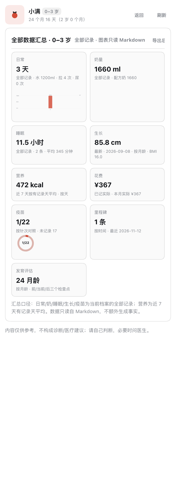
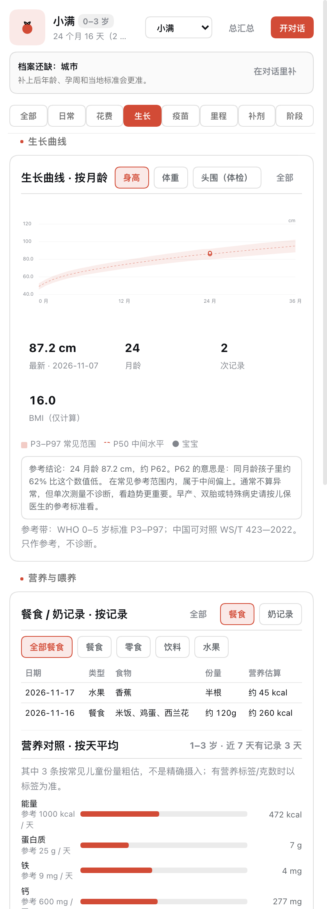
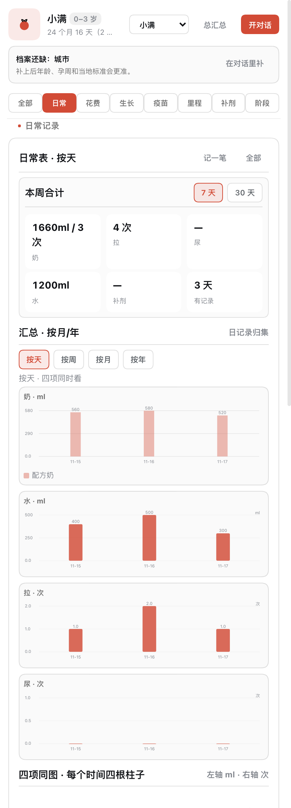

# dsh-ask-grow 🍅

[English](README.md) | [简体中文](README.zh-CN.md)


[](https://awesome-dsh-plugin.com)

给 [DeepSeek Harness](https://github.com/deepseek-ai/deepseek-harness)（`dsh`）用的**育儿档案**插件：每个孩子一份普通 Markdown 档案，覆盖孕期到 3 岁。

打开右侧栏的「问问」tab，或左栏的「问问」入口。看板读写的就是你能直接打开、diff、备份和编辑的 Markdown 文件。没有独立数据库，没有托管服务，也没有第二份数据源。

*非官方项目：由社区成员独立开发和维护，不是 DeepSeek 官方产品。*

## 截图







## 功能

| 模块 | 内容 |
|---|---|
| 档案 | 每个孩子一个工作区目录；支持孕期、新生儿和 0–3 岁阶段；从「问问」入口新建。 |
| 日常 | 奶、水、拉、尿、补剂和备注；「沿用昨天」只给建议，确认后才写入。 |
| 奶 | 品种、品牌/段数、量、时间和可选营养标签；奶量进入图表。 |
| 餐食 | 餐食/零食/饮料/水果、食物、份量和营养估算。 |
| 睡眠 | 夜间睡眠和午睡、入睡/醒来、时长和夜醒。 |
| 生长 | 身高、体重、头围；按月龄曲线和参考带。 |
| 疫苗 | 官方程序按“疫苗 + 针次”对照；自费/组合疫苗单独记计划。 |
| 体检 | 儿保体检、结果和建议；身高/体重/头围也可同步进生长表。 |
| 里程碑 | 第一次和阶段突破的时间线，与完整事件时间线分开。 |
| 评估 | 自评检查点和医院/儿保评估记录；只做筛查，不下诊断。 |
| 孕期 | 预产期来源、产检、体重/血压趋势、报告摘要、用药、饮食、待产包。 |
| 花费 | 实际花费；没记时给出明确标注的估算。 |
| 图表 | 奶/水/尿布、睡眠、生长、营养、疫苗、花费；全部读 Markdown 数据。 |
| 看板 | 最近更新、关键指标、待办、到点注意、快捷记录和分模块汇总。 |
| 设置 | 工作区、孩子、地区、隐私和开发模式都在本插件的 **Plugin Manager** 配置里。 |

## 数据结构

所有数据都是配置工作区下的普通 Markdown：

```text
child-doc/
  孕期-<名字>-<id>/
  <孩子>/
    docs/
      <孩子>-档案.md
      <孩子>-日常记录.md
      <孩子>-奶记录.md
      <孩子>-辅食记录.md
      <孩子>-睡眠记录.md
      <孩子>-数据-生长与健康.md
      <孩子>-疫苗计划.md
      <孩子>-里程碑.md
      <孩子>-时间线.md
      <孩子>-评估记录.md
      <孩子>-人格与偏好.md
      <孩子>-育儿花费.md
      ...
      <孩子>-档案索引.md
```

- 一个事实只进一张主表；日常视图是读取时 join 出来的。
- 图表和汇总不另存一份数据。
- 新文件带孩子名；旧的无前缀文件仍可读取。
- 写操作只经插件的 Markdown store，不改 DSH 会话存储。

## 安装

```bash
dsh plugin --profile web add "github:a903067276-rgb/dsh-ask-grow#main"
```

如果你的 DSH 需要重启加载 bundle，安装后重启一次。

## 要求

- 已在 DSH `0.2.2-rc.3` 验证；兼容范围写在 `package.json`。
- Node.js `22.19+`。
- 没有独立服务器、模型、数据库或通知系统。

## 隐私与边界

- 档案数据只留在你选择的工作区；插件不会上传到第三方服务。
- 写入前做隐私扫描。不要把证件号、电话、住址或医院报告原图写进备注。
- 插件只负责记录、对照和提醒，**不诊断、不开药、不替代儿科医生**。
- 营养和花费估算是估算值，不是实测事实。

## 语言

插件页标题/描述和详情页为中英文。插件内看板当前为中文；语言层已抽出，英文 UI 暂缓。

## 许可证

MIT，见 [LICENSE](LICENSE)。
