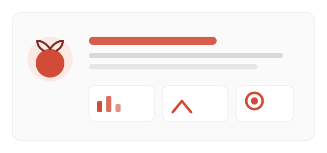

# dsh-ask-grow 🍅

[English](README.md) | [简体中文](README.zh-CN.md)


[](https://awesome-dsh-plugin.com)

**问问**：给 [DeepSeek Harness](https://github.com/deepseek-ai/deepseek-harness)（`dsh`）用的育儿档案插件。每个孩子一份普通 Markdown 档案，覆盖孕期到 3 岁。

打开右侧栏的「问问」tab，或左栏的「问问」入口。日常、奶与餐食、睡眠、生长、疫苗、体检、里程碑、评估观察和花费都写在你可读、可备份、可编辑的文件里。图表和汇总只是这些文件的只读投影，没有第二份数据库。

*非官方项目：由社区成员独立开发和维护，不是 DeepSeek 官方产品。*

## 截图



## 功能

- **每个孩子一份档案** —— 孕期和 0–3 岁孩子各有独立工作区目录。
- **数据可读** —— 所有记录都是 Markdown 表格，没有专有存储。
- **看板** —— 最近更新、关键指标、日常、生长曲线、疫苗、体检、里程碑、补剂、评估和花费。
- **图表来自文件** —— 奶量、水、尿布、睡眠、生长、营养、花费和孕期图表读的就是看板读的文件。
- **只给建议的沿用** —— 今天没记录时，只提示昨天数据；你确认后才写入。
- **设置在本插件入口** —— 工作区、孩子、隐私、地区都在 Plugin Manager 的插件配置里，不另设内部设置页。
- **浅色/暗色** —— 跟随 DSH 主题；插件内界面当前为中文，语言层已为后续本地化留好结构。

## 安装

```bash
dsh plugin --profile web add "github:a903067276-rgb/dsh-ask-grow#main"
```

如果你的 DSH 需要重启加载 bundle，安装后重启一次。

## 要求

- 已在 DSH `0.2.2-rc.3` 验证；兼容范围写在 `package.json`。
- Node.js 22.19+。
- 插件没有独立服务器、模型或数据库；使用 DSH 的会话、工作区和工具。

## 数据与隐私

- 档案数据只留在你配置的工作区：`child-doc/<孩子>/docs/`。
- 插件不会把档案数据发送到第三方服务。
- 不要把证件号、电话、住址或医院报告原图写入记录；插件写入前会做隐私扫描。
- 图表和估算用于记录和参考，不构成诊断、治疗或医疗建议。

## 设置

在 **插件入口 → 本插件配置** 里设置：

- 工作区根目录
- 孩子 / 孕期档案
- 国家 / 城市 / 隐私模式
- 开发模式（默认关闭）

这是唯一支持的设置入口；插件不另设第二套设置页。

## 范围

这个版本是育儿档案和看板，不是育儿百科、诊断工具，也不能替代儿科医生。

## 许可证

MIT，见 [LICENSE](LICENSE)。
