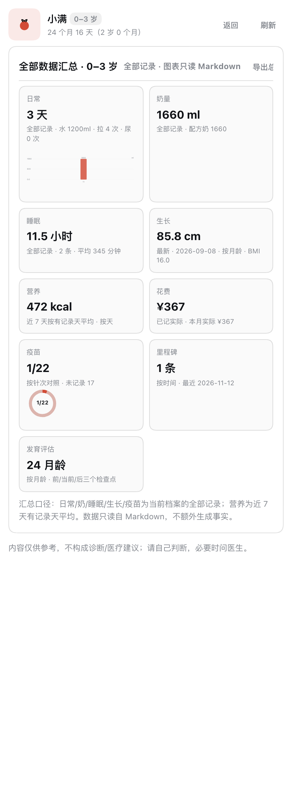

## 问问：有档案的育儿搭档

问问把孕期与 0–3 岁育儿数据放在一份份普通 Markdown 文件里，跟着 DSH 的工作区走，不锁在插件数据库里。

- **入口**：右侧栏「问问」tab；左栏「问问」入口可以选择或创建档案。
- **每个孩子一份档案**：日常、奶与餐食、睡眠、生长、疫苗、体检、里程碑、评估观察、花费。
- **图表就是文件的投影**：不改数据、不另存一份；改 Markdown 后活动档案自动刷新。
- **沿用昨天**：今天没记录时只给建议，你点确认后才写入；奶从奶记录读，不重复进日常表。
- **设置**：在「插件」入口的插件配置里，不另设插件内部设置页。
- **边界**：只做记录、对照和提醒；不诊断、不替代医生，不把估算当实际支出。

### English

**Ask & Grow** is a parenting archive for pregnancy and ages 0–3. It keeps one plain-Markdown archive per child inside your DSH workspace: daily care, milk and meals, sleep, growth, vaccines, checkups, milestones, assessment notes and expenses.

Open the **问问** tab in the right sidebar or the **问问** entry in the left rail. Charts and summaries are read-only projections of those files. Daily carry-over is proposal-only until you confirm. Settings live in this plugin's entry in Plugin Manager. It records, compares and reminds; it does not diagnose or replace a doctor.
